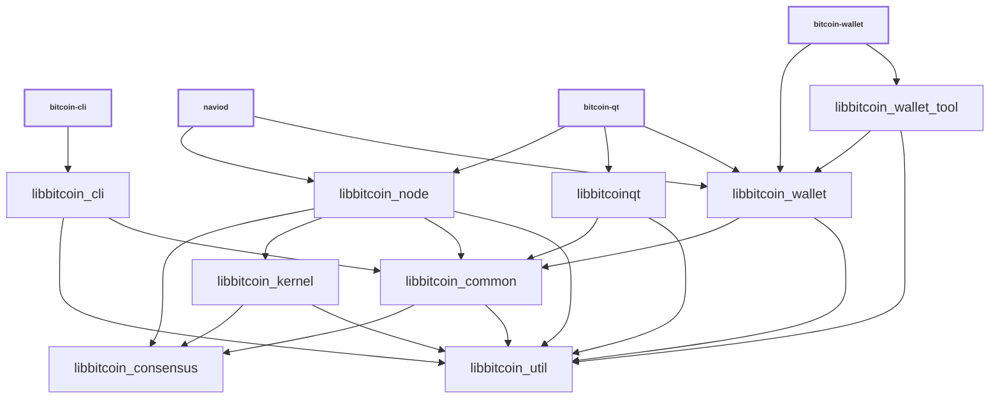

# Libraries

| Name                     | Description                                                                                                                                                            |
| ------------------------ | ---------------------------------------------------------------------------------------------------------------------------------------------------------------------- |
| _libbitcoin_cli_         | RPC client functionality used by _bitcoin-cli_ executable                                                                                                              |
| _libbitcoin_common_      | Home for common functionality shared by different executables and libraries. Similar to _libbitcoin_util_, but higher-level (see [Dependencies](#dependencies)).       |
| _libbitcoin_consensus_   | Stable, backwards-compatible consensus functionality used by _libbitcoin_node_ and _libbitcoin_wallet_ and also exposed as a [shared library](../shared-libraries.md). |
| _libnavioconsensus_      | Shared library build of static _libbitcoin_consensus_ library                                                                                                          |
| _libbitcoin_kernel_      | Consensus engine and support library used for validation by _libbitcoin_node_ and also exposed as a [shared library](../shared-libraries.md).                          |
| _libbitcoinqt_           | GUI functionality used by _bitcoin-qt_ executable                                                                                                                      |
| _libbitcoin_node_        | P2P and RPC server functionality used by _naviod_ and _bitcoin-qt_ executables.                                                                                        |
| _libbitcoin_util_        | Home for common functionality shared by different executables and libraries. Similar to _libbitcoin_common_, but lower-level (see [Dependencies](#dependencies)).      |
| _libbitcoin_wallet_      | Wallet functionality used by _naviod_ and _bitcoin-wallet_ executables.                                                                                                |
| _libbitcoin_wallet_tool_ | Lower-level wallet functionality used by _bitcoin-wallet_ executable.                                                                                                  |
| _libbitcoin_zmq_         | [ZeroMQ](../zmq.md) functionality used by _naviod_ and _bitcoin-qt_ executables.                                                                                       |

## Conventions

- Most libraries are internal libraries and have APIs which are completely
  unstable! There are few or no restrictions on backwards compatibility or rules
  about external dependencies. Exceptions are _libbitcoin_consensus_ and
  _libbitcoin_kernel_ which have external interfaces documented at
  [../shared-libraries.md](../shared-libraries.md).

- Generally each library should have a corresponding source directory and
  namespace. Source code organization is a work in progress, so it is true that
  some namespaces are applied inconsistently, and if you look at
  [`libbitcoin_*_SOURCES`](../../src/Makefile.am) lists you can see that many
  libraries pull in files from outside their source directory. But when working
  with libraries, it is good to follow a consistent pattern like:

  - _libbitcoin_node_ code lives in `src/node/` in the `node::` namespace
  - _libbitcoin_wallet_ code lives in `src/wallet/` in the `wallet::` namespace
  - _libbitcoin_util_ code lives in `src/util/` in the `util::` namespace
  - _libbitcoin_consensus_ code lives in `src/consensus/` in the `Consensus::`
    namespace

## Dependencies

- Libraries should minimize what other libraries they depend on, and only
  reference symbols following the arrows shown in the dependency graph below:

<table><tr><td>

</td></tr><tr><td>

**Dependency graph**. Arrows show linker symbol dependencies. _Consensus_ lib
depends on nothing. _Util_ lib is depended on by everything. _Kernel_ lib
depends only on consensus and util.

</td></tr></table>

- The graph shows what _linker symbols_ (functions and variables) from each
  library other libraries can call and reference directly, but it is not a call
  graph. For example, there is no arrow connecting _libbitcoin_wallet_ and
  _libbitcoin_node_ libraries, because these libraries are intended to be
  modular and not depend on each other's internal implementation details. But
  wallet code is still able to call node code indirectly through the
  `interfaces::Chain` abstract class in
  [`interfaces/chain.h`](../../src/interfaces/chain.h) and node code calls
  wallet code through the `interfaces::ChainClient` and
  `interfaces::Chain::Notifications` abstract classes in the same file. In
  general, defining abstract classes in
  [`src/interfaces/`](../../src/interfaces/) can be a convenient way of avoiding
  unwanted direct dependencies or circular dependencies between libraries.

- _libbitcoin_consensus_ should be a standalone dependency that any library can
  depend on, and it should not depend on any other libraries itself.

- _libbitcoin_util_ should also be a standalone dependency that any library can
  depend on, and it should not depend on other internal libraries.

- _libbitcoin_common_ should serve a similar function as _libbitcoin_util_ and
  be a place for miscellaneous code used by various daemon, GUI, and CLI
  applications and libraries to live. It should not depend on anything other
  than _libbitcoin_util_ and _libbitcoin_consensus_. The boundary between _util_
  and _common_ is a little fuzzy but historically _util_ has been used for more
  generic, lower-level things like parsing hex, and _common_ has been used for
  bitcoin-specific, higher-level things like parsing base58. The difference
  between util and common is mostly important because _libbitcoin_kernel_ is not
  supposed to depend on _libbitcoin_common_, only _libbitcoin_util_. In general,
  if it is ever unclear whether it is better to add code to _util_ or _common_,
  it is probably better to add it to _common_ unless it is very generically
  useful or useful particularly to include in the kernel.

- _libbitcoin_kernel_ should only depend on _libbitcoin_util_ and
  _libbitcoin_consensus_.

- The only thing that should depend on _libbitcoin_kernel_ internally should be
  _libbitcoin_node_. GUI and wallet libraries _libbitcoinqt_ and
  _libbitcoin_wallet_ in particular should not depend on _libbitcoin_kernel_ and
  the unneeded functionality it would pull in, like block validation. To the
  extent that GUI and wallet code need scripting and signing functionality, they
  should be get able it from _libbitcoin_consensus_, _libbitcoin_common_, and
  _libbitcoin_util_, instead of _libbitcoin_kernel_.

- GUI, node, and wallet code internal implementations should all be independent
  of each other, and the _libbitcoinqt_, _libbitcoin_node_, _libbitcoin_wallet_
  libraries should never reference each other's symbols. They should only call
  each other through [`src/interfaces/`](`../../src/interfaces/`) abstract
  interfaces.

## Work in progress

- Validation code is moving from _libbitcoin_node_ to _libbitcoin_kernel_ as
  part of
  [The libnaviokernel Project #24303](https://github.com/bitcoin/bitcoin/issues/24303)
- Source code organization is discussed in general in
  [Library source code organization #15732](https://github.com/bitcoin/bitcoin/issues/15732)
